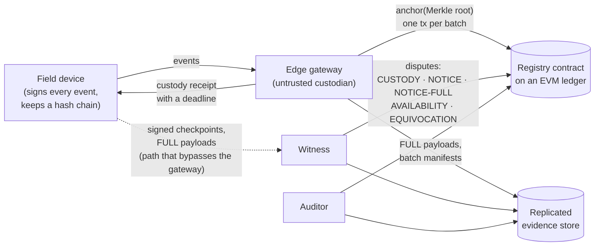

# PROVE-CPS

**Omission accountability for blockchain-anchored cyber-physical evidence.**

An evidence log anchored on a blockchain can be perfectly intact and still lie by omission. The edge gateway decides which device events get committed, so it can quietly drop the ones that would reveal an attack. Hashes, Merkle roots and signatures protect what *was* logged. They say nothing about what was left out.

PROVE-CPS makes omissions **detectable and attributable on-chain**. Within a bounded time, every event of an honest device ends one of two ways. Either it is provably anchored, or the gateway that held custody of it is convicted by a smart contract. An honest gateway that only suffers network outages is never convicted.

This repository contains:

- the registry smart contract;
- the device, gateway, witness and auditor agents;
- the attack harness, the baselines and the TLA+ model;
- the ledger testbed;
- every experiment log, with the scripts that turn the logs into the reported numbers.

---

## Contents

1. [System model](#1-system-model)
2. [How the protocol works](#2-how-the-protocol-works)
3. [Guarantees](#3-guarantees)
4. [Code walkthrough](#4-code-walkthrough)
5. [Experiments](#5-experiments)
6. [Results](#6-results)
7. [Reproducing](#7-reproducing)
8. [Testbeds](#8-testbeds)

---

## 1. System model



| Party | Trust | Role |
|---|---|---|
| **Device** | Honest; its key may leak, and leakage is handled by revocation | Signs every event and extends a per-device hash chain. Retransmits until it holds a receipt. Sends periodic signed checkpoints to its witness. |
| **Gateway** | **Untrusted**: may drop, delay, reorder, equivocate, refuse custody or stall disputes, and may time any of these to a real network partition | Receipts events, decides FULL or DIGEST under the committed policy, and anchors batches. |
| **Witness** | At least one honest witness per protected device | Receives the device's checkpoints over a path that does not go through the gateway, and raises disputes on-chain. |
| **Registry** | The ledger is live and safe | A clocked adjudicator. It decides every dispute against block time and outputs `Dismissed`, `Late` or `Convicted`. |
| **Evidence store** | Replicated; readable by auditors | Holds FULL payloads, batch manifests and published custody logs. |

Each event is one of two classes:

- **FULL** events (out-of-envelope values, large steps) must have their *content* anchored within `τ_FULL`.
- **DIGEST** events only need their *existence* anchored within `τ_DIGEST`.

The class is decided by a **selection policy committed on-chain**, which reads device-signed features. The gateway therefore cannot hide a suppression by claiming the event was "not selected".

## 2. How the protocol works

### Four design insights

The code comments refer to these by name.

| | Insight | What it removes |
|---|---|---|
| **I1** | **Device-signed hash chains.** `H_c = keccak(H_{c-1}, eventHash(e_c))`. One anchored head commits to the device's whole prefix. | Mid-stream deletion and reordering. Only truncation of the tail is left, and truncation is a question of deadlines. |
| **I2** | **Custody receipts.** A gateway-signed EIP-712 receipt for counter `c`, with deadline `d`, transfers liability for events `≤ c`. | "I never received it" after the gateway has acknowledged an event. |
| **I3** | **Committed selection policy.** The rules (`feature op threshold`) are stored in the registry and activated by the event's device-signed timestamp. | "It was not selected" as a cover for dropping a FULL event. |
| **I4** | **Ledger as a clocked adjudicator.** Every dispute has a response window measured in block time, never block height. | Indefinite stalling. A missed anchoring deadline yields `Late`; only a missed *response* yields `Convicted`. |

### Honest path

The honest path costs **one storage write per batch**, whatever the number of devices or events.

1. The device emits a signed event and extends its chain.
2. The gateway verifies the signature and the chain link. It then returns a receipt with deadline `now + τ_class`.
3. The gateway runs **earliest-deadline stabbing**. When the earliest pending deadline minus a safety margin `δ` arrives, it closes one batch. The batch holds the latest head of every device that has receipted but unanchored events.
4. The gateway calls `anchor(root)`. That costs 48,086 gas.

### Dispute path

Disputes are used only when something is wrong.

| Dispute | Raised when | The gateway clears it by | Otherwise |
|---|---|---|---|
| `CUSTODY` | A receipted head is not covered by its deadline | Proving coverage: device checkpoint + Merkle proof + chain link | `Late` (anchored after the deadline) or `Convicted` (never) |
| `NOTICE` | A head has stayed unreceipted for `ν` seconds | Proving coverage, or anchoring it now (`anchorAndRespond`) | `Convicted` |
| `NOTICE-FULL` | As `NOTICE`, but the event is FULL under the committed policy | Coverage **and** the payload | `Convicted` |
| `AVAILABILITY` | A receipted FULL event's payload is missing | Publishing the payload | `Convicted` |
| `EQUIVOCATION` | Two receipts for one counter disagree | — | Immediate conviction |
| Device equivocation | Two device checkpoints for one counter disagree | — | The device key is revoked |

Griefing is bounded in three ways:

- A **challenger bond** makes spam cost something.
- A **proven frontier** rejects challenges below a head that has already been proven covered (`AlreadyCovered`).
- `anchorAndRespond` answers a challenge in a single O(1) transaction.

## 3. Guarantees

Notation:

| Symbol | Meaning | Default |
|---|---|---|
| `Δ_L` | Ledger inclusion delay: block timestamp minus submission time | measured |
| `ν` | Notice threshold (how long a head may stay unreceipted) | 15 s |
| `p` | Checkpoint period from device to witness | 10 s |
| `τ_k` | Anchoring deadline for class k | 30 s FULL, 300 s DIGEST |
| `σ` | Clock tolerance a device accepts on receipt deadlines | 5 s |
| `W` | Response window | 300 s |
| `O_g` | Longest outage an honest gateway must survive | 120 s in the experiments |
| `δ` | Safety margin of the scheduler | 3 s |
| `θ` | Device retransmission period | 5 s |

**Accountability.** This is the property the harness scores per suppressed event. For every event of an honest device that has a witness, one of two things happens. Either a head covering the event is anchored, or a dispute naming the event convicts its custodian. The bounds below give the time limits. In addition, an honest gateway is never convicted.

**Witness necessity.** Without a path from device to auditor that bypasses the gateway, suppression cannot be told apart from an outage. The best possible outcome is then an *unattributed* alarm. Detection can also never be faster than `T_w + Δ_L`.

**Price of outage tolerance.** A protocol that never convicts a gateway for an outage of length `O_g` cannot attribute faster than `O_g + Δ_L`. Non-frameability requires `W > O_g + Δ_L`, and this condition is necessary up to clock skew.

**Achievability.** PROVE-CPS meets:

```
Δ_d ≤ ν + p + τ_k + σ + Δ_L + ρ          (detection)
Δ_a ≤ Δ_d + W + Δ_L + ρ                  (attribution)     ρ ≤ 3 s of integer-timestamp rounding
```

`harness.theorem_bounds` checks every event against exactly these formulas, using the largest `Δ_L` that the trial replays.

**Minimal batches.** For the given receipt deadlines, earliest-deadline stabbing uses the fewest anchors of any schedule that meets them.

## 4. Code walkthrough

```
contracts/      Solidity (Foundry): the registry, baseline contracts, tests
prototype/      Python agents (provecps/), attack harness, analysis, figures
formal/         TLA+ model of the dispute protocol and TLC configurations
experiments/    ledger-latency campaigns, campaign scripts, every trial log
testbed/        4-validator Besu QBFT network and a generic deployment script
```

### `contracts/`

| File | Contents |
|---|---|
| [`src/Registry.sol`](contracts/src/Registry.sol) | The PROVE-CPS registry. **Admin:** `registerGateway`, `registerDevice`, `setPolicy`. **Honest path:** `anchor`. **Disputes:** `challengeCustody`, `notice`, `noticeFull`, `challengeAvailability`. **Answers:** `respondCoverage`, `respondNoticeFull`, `anchorAndRespond`, `respondPayload`. **Resolution:** `finalize`, `proveEquivocation`, `proveDeviceEquivocation`, `withdraw` (bonds). **Pure helpers that the Python agents mirror byte for byte:** `receiptDigest`, `checkpointDigest`, `eventHash`, `chainStep`, `leafOf`, `requiresFull`. Constructor: `Registry(responseWindow, bond)`. |
| [`src/Baselines.sol`](contracts/src/Baselines.sol) | On-chain archetypes for the cost comparison: `FullLog` (B1, every event on-chain), `HashLog` (B2, per-event hash), `MerkleLog` (B3/B5, batched roots), `SequencedLog` (B4, gateway-sequenced batches). |
| [`test/Registry.t.sol`](contracts/test/Registry.t.sol) | 29 tests, organised by attack (A1–A7) plus non-frameability. Includes fuzz tests: random honest histories are never convicted. |
| [`test/Baselines.t.sol`](contracts/test/Baselines.t.sol) | 5 tests of the baseline contracts. |

Contracts are compiled with Solidity 0.8.30 for EVM `paris`, and depend on OpenZeppelin `ECDSA`, `EIP712` and `MerkleProof`. All times are block **timestamps**. On an on-demand chain the block height stops advancing while the chain is idle, so it cannot serve as a clock.

### `prototype/provecps/`: the protocol agents

The agents are transport-agnostic: the caller delivers messages and drives the clock. The same classes run inside the discrete-event harness and on real hardware.

| Module | What it does |
|---|---|
| [`crypto.py`](prototype/provecps/crypto.py) | keccak, EIP-712 digests, secp256k1 signing and recovery (libsecp256k1 via `coincurve` when installed), and Merkle trees. Every function has an on-chain twin. The ABI words are hand-encoded, which is about 10× faster than `eth_abi`. |
| [`messages.py`](prototype/provecps/messages.py) | Off-chain messages: `Header`, `EventMsg`, `SignedHead`, `Receipt`, `CheckpointMsg`, `AvailabilityEvidence`, `NoticeFullEvidence`. |
| [`policy.py`](prototype/provecps/policy.py) | The selection policy, the off-chain twin of `Registry.requiresFull`. It holds versioned rules over device-signed integer features. |
| [`device.py`](prototype/provecps/device.py) | Device agent. It signs events, extends the chain and retransmits every `θ` until receipted. It evaluates the public policy itself and rejects any receipt whose deadline exceeds `now + τ_class + σ`, so a FULL event cannot be given a DIGEST deadline. It also sends checkpoints and FULL payloads to its witness. Its only dependencies are keccak and secp256k1. |
| [`gateway.py`](prototype/provecps/gateway.py) | The honest gateway (`Honest`): verify, receipt, replicate FULL payloads, schedule batches by stabbing, and answer disputes. Each attack is a `Strategy` subclass that overrides individual decisions; everything else, including how disputes are answered, is the same code. Strategies: `TailTruncation`, `MidStreamDrop`, `Stonewall`, `Disguise`, `Equivocate`, `Delay`, `RefuseCustody`, `SlowWalk`. |
| [`witness.py`](prototype/provecps/witness.py) | `Witness` turns checkpoints into on-chain disputes and finalizes them when the window closes. It has two dispute policies. **Strict:** one dispute per overdue receipt per checkpoint period, so every suppressed event is named. **Economy:** at most one open dispute per device. Also contains `Auditor` (SILENCE alarms and the outcome per event) and `GriefWitness` (a challenge-flooding adversary used for the griefing experiment). |
| [`ledger.py`](prototype/provecps/ledger.py) | `Anvil` runs a private chain. `SimLedger` runs the **real registry bytecode** in simulated time: automine is off, each block is mined at its simulated timestamp, and inclusion delays are drawn from a measured `Δ_L` distribution. `LedgerPort` holds back a party's transactions during its outage. |
| [`sim.py`](prototype/provecps/sim.py) | Discrete-event core: clock, event queue, lossy links with outage windows. |
| [`store.py`](prototype/provecps/store.py) | The replicated evidence store. |
| [`schedule.py`](prototype/provecps/schedule.py) | Batch scheduling in isolation. `stabbing` gives the minimal batches; `fixed_interval` gives the Merkle-batching schedule with the same guarantee. |
| [`hai.py`](prototype/provecps/hai.py) | HAI 23.05 replay. Each non-constant tag becomes one device, reporting by exception with a 60 s heartbeat. It also computes the signed policy features: `f0` is the position within the commissioning envelope in permille, `f1` the step since the last report, `f2` a heartbeat flag. The envelope is calibrated on training data only. |
| [`baselines.py`](prototype/provecps/baselines.py) | Baselines B1–B6, scored on the same traces and attack windows. Each one gets the *strongest* auditor its evidence admits: signed events, heartbeats and SILENCE alarms, plus a witness in the `+W` variants. Its failures are therefore structural, not a sign of a weak implementation. |
| [`harness.py`](prototype/provecps/harness.py) | One trial: replay one attack window through devices → gateway → registry, with witnesses and an auditor. It deploys a fresh `Registry` and scores every suppressed event as `attributed`, `late`, `flagged-unattributed`, `covered` or `undetected`, and checks its delays against the bounds. `Params` holds every protocol and experiment knob. |

**Attack strategies**, all defined in `harness.strategies`:

| ID | Gateway behaviour |
|---|---|
| A1 | Tail truncation: keeps receipting the target devices, so they free their buffers, but never anchors their events from attack start |
| A2 | Mid-stream drop: deletes the target events generated inside the attack window and keeps anchoring later heads |
| A3 | Stonewall: silently ignores the target devices from attack start, with no receipts and no anchors |
| A4 | Disguise: takes custody of FULL events and anchors them, but treats them as DIGEST and deletes the payload |
| A5 | Equivocation: shows the device one history and the public custody log another, for the same counter |
| A6 | Delay: anchors, but `delay_extra` seconds after the deadline, then answers to avoid conviction |
| A7 | Stonewall timed to a real network partition |
| A8 | Custody refusal: never receipts the target devices, so it owes no availability, and answers every plain notice by anchoring the head. Without `NOTICE-FULL`, the FULL payloads would never be published. |
| A8-v1 | Ablation: A8 against the registry without `NOTICE-FULL` |
| A9 | Slow walk: the worst case for detection that the bound allows |
| `*-unw` | The same attack aimed only at devices **without** a witness (the witness-necessity regime) |
| `honest`, `honest-partition`, `honest-grief` | Controls for non-frameability |

A9 holds each receipt for just under `ν`, stretches its deadline by `σ`, and then never anchors.

**Baselines** (in `baselines.py`):

| ID | Design |
|---|---|
| B1 | Full on-chain log |
| B2 | Per-event hash anchoring |
| B3 | Merkle batching |
| B4 | Gateway-sequenced batches |
| B5 | Device hash chain anchored by the gateway, with no receipts, witness or policy |
| B6 | Transparency log with signed inclusion promises and gossip |

### `prototype/`: drivers and analysis

| Script | Purpose |
|---|---|
| [`run_matrix.py`](prototype/run_matrix.py) | Runs the attack matrix in parallel. Each worker has its own Anvil, restarted every few trials. It is resumable: trials already in the output are skipped. `--variants "k=v,k=v;…"` overrides any `Params` field. |
| [`analyze.py`](prototype/analyze.py) | Outcome shares, delays against the bounds, convictions, dispute counts and gas, per strategy and per witness regime. |
| [`tables.py`](prototype/tables.py) | The attack × system matrix, generated as LaTeX from the logs (written to `paper/tables/`). |
| [`figs.py`](prototype/figs.py) | Cost-frontier and outage-sweep figures, as PDF and PNG (written to `paper/figs/`). |
| [`pareto.py`](prototype/pareto.py) | Gas per hour as a function of `τ_FULL`. Compares PROVE-CPS (two-class stabbing), one-class stabbing, fixed-interval Merkle batching, and one transaction per event. |
| [`policy_sweep.py`](prototype/policy_sweep.py) | Sensitivity to the policy and to an envelope-aware attacker. For each envelope margin and step threshold it reports the share of FULL events, the enrichment inside attack windows, the recall over the 52 attack windows, and the gas saving. |
| [`measure_gas.py`](prototype/measure_gas.py) | Steady-state gas of each design's honest-path call, measured with real HAI payloads. |
| [`bench_device.py`](prototype/bench_device.py) | Device-side CPU and memory cost per event, using the exact `Device` code. |
| [`tests/test_crypto_vs_contract.py`](prototype/tests/test_crypto_vs_contract.py) | 382 byte-level cross-checks of every Python encoder against the deployed bytecode. |

### `formal/`

[`ProveCPS.tla`](formal/ProveCPS.tla) is a discrete-time model of one device, one gateway, one honest witness and the registry. With `HONEST = FALSE`, the gateway may drop, delay or never receipt events, anchor late or never, and answer late or never. TLC checks three invariants:

- `NonFrameability`
- `Detection` (within `BD`)
- `Attribution` (within `BA`)

Each property has two configurations:

- `*_ok.cfg` sets the parameter at the bound and should pass.
- `*_tight.cfg` sets it one tick tighter and should produce a counterexample, which shows the bound cannot be improved in the model.

The model also contains a griefing witness that may post a `NOTICE` for any head at any time. Without it the honest gateway would never be challenged, and non-frameability would hold trivially.

```bash
# needs Java 11+; put the official tla2tools.jar (github.com/tlaplus/tlaplus releases) in formal/tools/
formal/run_tlc.sh 16          # all six configurations -> formal/results/summary.txt
```

[`results/summary.txt`](formal/results/summary.txt) holds the TLC verdicts, state counts and run times.

### `experiments/`

| Path | Contents |
|---|---|
| [`latency/measure_inclusion.py`](experiments/latency/measure_inclusion.py) | Measures `Δ_L` for `Registry.anchor`: block timestamp minus submission time, the receipt lag seen by the client, the RPC round trip and the block age. |
| [`latency/load_gen.py`](experiments/latency/load_gen.py) | Background load at a fixed rate with calldata-heavy transactions, to measure under stress. |
| [`latency/besu_campaign.sh`](experiments/latency/besu_campaign.sh) | Three Besu runs: idle, under load, and with one of four validators stopped. |
| [`latency/cold_start.sh`](experiments/latency/cold_start.sh) | Inclusion delay on an on-demand chain after it has been idle. |
| [`latency/summarize_v2.py`](experiments/latency/summarize_v2.py) | Per profile: p50, p99 and max of `Δ_L`, the share above 3 s, and the block-timestamp skew. |
| [`run_v3.sh`](experiments/run_v3.sh) | The v3 campaign: headline matrix, robustness runs, and seeds 1–9. |
| [`results/`](experiments/results) | Every trial log (`*.jsonl.gz`, one JSON object per trial), the latency CSVs, gas, the Pareto frontier, the policy sweep and the summaries. [`paper_numbers_v2.py`](experiments/results/paper_numbers_v2.py) recomputes the headline numbers from a matrix log. [`numbers_v3.py`](experiments/results/numbers_v3.py) computes the robustness results, the seed statistics and the bound checks over every trial. |

## 5. Experiments

- **Workload.** The HAI 23.05 industrial control dataset: both test splits, with **all 52 labelled attacks**. Each trial replays one attack window, from 600 s before it to 900 s after it. The `boiler` process devices are the targets, and only some devices have a witness. This exercises both the achievability regime and the witness-necessity regime.
- **Ledger.** Every verdict comes from the deployed registry bytecode. Inclusion delays are replayed from measured `Δ_L` profiles (`Params.ledger`):

  | Profile | Source |
  |---|---|
  | `poa` | Permissioned PoA network, 2,000 samples |
  | `besu` | Besu QBFT, idle |
  | `besu-load` | Besu QBFT, 17 tx/s of 2 KB background traffic |
  | `besu-fault` | Besu QBFT with 1 of 4 validators stopped |

- **Campaigns.**

  | Log | Trials | Contents |
  |---|---|---|
  | `matrix_v2` | 1,404 | 52 attacks × 27 strategy–policy pairs |
  | `frame_sweep_v2` | 294 | Outage length against response window |
  | `grief_v2` | 28 | Challenge flooding, with and without a bond |
  | `matrix_v3` | 1,404 | Headline matrix with the 2,000-sample delay profile |
  | `robust_v3` | 1,372 | Faulty and loaded ledgers; two witnesses with one corrupt; sweeps of `ν` and `δ` |
  | `seeds_v3` | 7,020 | Seeds 1–9 of the 15 strict strategies, for confidence intervals |

  The headline campaign is v3: 10,118 trials, including the v2 sweep and griefing runs. `matrix_v2` is kept for comparison; it replayed an earlier 50-sample delay profile.

## 6. Results

These are the v3 results, with 0 harness errors in every campaign. The numbers come from [`paper_numbers_v2.py`](experiments/results/paper_numbers_v2.py), which writes `paper_numbers_v3.json` when run on `matrix_v3`, and from [`numbers_v3.py`](experiments/results/numbers_v3.py), which writes `numbers_v3.json`.

| Result | Value |
|---|---|
| Attribution, devices with a witness | Every suppressed event the policy requires was attributed, under A1–A9 |
| Delay bounds | Across all strict trials (every seed and robustness run), 3,117,500 detected and 3,109,689 attributed events met their bounds. A9 came within **3.9 s** of the detection bound, and within 3.9–4.9 s across the ten seeds. |
| Seeds | Over ten seeds every outcome count was identical; only delays moved, by at most 1 s |
| `NOTICE-FULL` ablation (A8) | **v1:** 7,811 of 7,811 FULL payloads lost, no conviction. **v2:** 7,811 of 7,811 attributed. |
| Equivocation (A5) | Proven in 52 of 52 trials, within 13 s |
| Devices without a witness | Flagged but never attributed, as witness necessity predicts |
| Faulty ledger (1 of 4 Besu validators stopped) | Bounds widen by 3.1 s; every required event was still attributed within them; A9 came within 4.0 s |
| Loaded ledger | The 10.2 s stall widens the bounds by 7.3 s; everything was still attributed; A9 came within 3.2 s |
| Two witnesses, one colluding | No outcome changed. With only the colluding witness, nothing was attributed. |
| `ν` from 8 to 60 s | A9 stays within 4.9 s of the bound at every `ν` |
| `δ` on the faulty ledger | Honest `Late` anchors in 14 trials: 316 at δ = 1 s, 124 at δ = 3 s, 0 at δ = 6 s. No conviction at any δ. |
| Honest gateways | **0 convictions in 1,388 honest v3 trials** (rule of three: below 0.22% at 95%), including 680 with a 120 s partition. 107,919 challenges from a flooding witness also produced no conviction. |
| Outage sweep | The predicted conviction boundary matches **294 of 294** verdicts |
| Cost | `anchor` = 48,086 gas, within 0.7% of a plain Merkle-root anchor. **71% less gas** than fixed-interval Merkle batching at a 30 s FULL deadline, and 85% less at 10 s. |

Measured ledger inclusion delay `Δ_L` (p50 / p99 / max):

| Ledger | p50 | p99 | max |
|---|---|---|---|
| PoA network | 1.88 s | 1.93 s | 2.89 s |
| Besu QBFT, idle | 1.78 s | 1.85 s | 2.73 s |
| Besu QBFT, under load | 1.75 s | 1.84 s | 10.2 s (one transaction-pool stall) |
| Besu QBFT, 1 of 4 validators stopped | 1.81 s | 5.84 s | 5.96 s |

**Policy trade-off** (`policy_sweep.json`). The default policy marks FULL any reading 5% outside the commissioning envelope or any step of 90% of it. Under that policy, a FULL event falls on a witnessed target device in 27 of the 52 attack windows. A zero-margin policy covers 52 of 52 windows, but its gas saving drops from 72% to 21%. Every DIGEST event's *existence* is protected under any policy.

## 7. Reproducing

**Requirements:**

- Python 3.12+ and Foundry (`forge`, `anvil`).
- Docker, only for the Besu testbed.
- Java, only for TLC.

```bash
# contracts: 34 tests, including fuzz tests with 2,000 runs each
cd contracts
forge install foundry-rs/forge-std@v1.17.0 OpenZeppelin/openzeppelin-contracts@v5.0.2   # into lib/ (not versioned)
forge build && forge test && cd ..

# Python environment
python -m venv .venv && . .venv/bin/activate        # Windows: .venv\Scripts\activate
pip install -r prototype/requirements.txt

# cross-check the Python encoders against the contract (needs anvil on 127.0.0.1:8645)
anvil --port 8645 &  python prototype/tests/test_crypto_vs_contract.py
```

**Re-analyse the committed logs.** No dataset is needed.

```bash
gunzip -k experiments/results/*.jsonl.gz
python prototype/analyze.py  experiments/results/matrix_v3.jsonl
python prototype/tables.py   experiments/results/matrix_v3.jsonl
(cd experiments/results && python paper_numbers_v2.py matrix_v3.jsonl > paper_numbers_v3.json \
   && python numbers_v3.py matrix_v3.jsonl robust_v3.jsonl seeds_v3.jsonl > numbers_v3.json)
python prototype/figs.py
python experiments/latency/summarize_v2.py experiments/results/latency_v2/*.csv
```

**Re-run the experiments.** These need the dataset. HAI 23.05 (CC BY-SA 4.0) is not redistributed here. Download it from the HAI repository (`icsdataset/hai`) and place the `hai-23.05` CSV files in `data/hai/hai-23.05/`.

```bash
python prototype/run_matrix.py --out matrix.jsonl --splits test1,test2 \
       --strategies all --policies strict,economy --workers 12 --anvil "$(which anvil)"

# example: two witnesses, one of them corrupt, on the faulty-validator ledger profile
python prototype/run_matrix.py --out robust.jsonl --strategies A1,A9 --policies strict \
       --variants "ledger=besu-fault,witnesses=2,silent_witnesses=1" --anvil "$(which anvil)"

python prototype/pareto.py experiments/results/pareto.json
python prototype/policy_sweep.py experiments/results/policy_sweep.json
```

## 8. Testbeds

### Besu QBFT (`testbed/besu/`)

| Item | Value |
|---|---|
| Besu | `hyperledger/besu:26.9.0` (pinned) |
| Consensus | QBFT, 4 validators, 2 s block period, 4 s round timeout; tolerates f < n/3 |
| Chain ID | 20271 |
| Fees | Zero base fee and `--min-gas-price=0`. Gas *units* are still metered, so gas figures compare with public EVM chains. |
| RPC | `localhost:8545`–`8548` |
| Subnet | `172.31.27.0/24` |

```bash
cd testbed/besu
./setup.sh                     # keys, genesis and docker-compose.yml (refuses to overwrite; --force regenerates)
docker compose up -d           # start the 4 validators
../deploy.sh besu.vars         # deploy Registry, register a gateway and a device, anchor one batch
docker compose down
```

Validators run with `NET_ADMIN`, so experiments can inject delay, loss and partitions with `tc` from inside a container.

[`besu.vars`](testbed/besu/besu.vars) contains only the **well-known public Anvil development keys**, which are funded only in this private genesis. Never use them on a public network. For any other network, put the keys in a git-ignored `.env` file and pass it to `deploy.sh`. A vars file defines `RPC`, `RESPONSE_WINDOW`, `ADMIN_KEY`, `GATEWAY_KEY`, `GATEWAY_ADDR` and `DEVICE_ADDR`.

### Permissioned PoA network (`testbed/purechain/`)

This is a go-ethereum-based permissioned PoA network with on-demand block production. It was used for the realistic latency profile (`poa`). Only the deployed registry address is stored here; the experiment keys are never committed.
